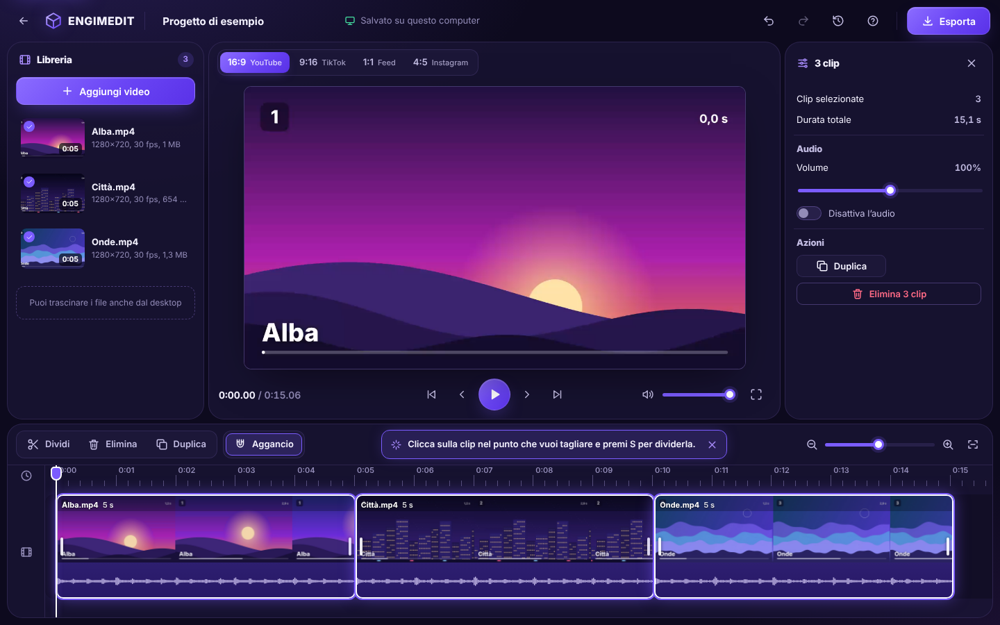

# EngimEdit

Editor video nel browser pensato per chi non ha mai montato un video: aggiungi le clip, tagliale, dividile, riordinale ed esporta un MP4 pronto per YouTube, TikTok o Instagram. I video restano sul computer dell'utente e non vengono mai caricati su un server.



## Provarla subito

Ci sono tre modi, dal più semplice al più completo.

1. **Online:** la versione pubblicata è su https://claude.ai/artifact/6zxX7JPQuNf9xewV1VFjw6. Aprendola con un account claude.ai, i progetti si sincronizzano tra computer diversi; senza account l'app funziona in modalità ospite.
2. **Doppio clic:** apri `dist/index.html` con Chrome o Edge. Il file è autosufficiente e non serve installare nulla. Questa modalità è verificata con Chromium, inclusi salvataggio ed esportazione.
3. **Server locale:** con Node.js 20 o successivo, esegui `node scripts/serve.mjs` e apri http://localhost:8080.

Per un primo giro di 3 minuti: *Apri EngimEdit* → *Prova il progetto di esempio* → segui il tutorial → clicca su una clip e premi **S** → trascina un bordo → *Esporta*.

## Funzioni

Il flusso di lavoro si ispira a DaVinci Resolve (Media Pool, timeline multitraccia con strumenti dedicati, Inspector, colore, Fairlight essenziale, Deliver), restando semplice per chi inizia.

- **Project Manager:** creazione, apertura, rinomina, duplicazione ed eliminazione con annullamento; **ricerca** e **ordinamento** (ultima modifica, creazione, nome, durata); **Esporta progetto (.json)** e **Importa progetto** per il backup su disco. Salvataggio automatico con indicatore di stato.
- **Media Pool:** video (MP4, MOV, WebM, M4V e, se il browser li legge, MKV e AVI), **immagini** (PNG, JPG, WebP; 5 s predefiniti, modificabili) e **audio** (MP3, WAV, M4A, OGG, AAC). Cartelle rapide *Tutti / Clip / Immagini / Audio*, miniature, forma d'onda e messaggi chiari per i file illeggibili.
- **Timeline multitraccia:** **V1** sequenza principale con ripple, **V2** sovrapposizione per immagini, **titoli** e **livelli di regolazione** (Adjustment Clip), **A1** per musica e voce con forma d'onda. Strumenti **A** Puntatore, **B** Lametta, **T** Slip, **N** Aggancio magnetico. **Marker** colorati (**M**) sulla timeline o sulla clip, con aggancio e salto rapido. Menu contestuale: etichetta colore (6 colori), disattiva/attiva (**D**), copia attributi (**Ctrl+C**) e incolla attributi (**Alt+V**) con scelta dei gruppi.
- **Inspector:** *Trasforma* (zoom collegato o X/Y, posizione, rotazione, capovolgi, ripristina), *Ritaglio*, *Zoom dinamico* (Zoom in / Zoom out), *Composito* per V2 (opacità e metodi di fusione Normale, Scolora, Moltiplica, Sovrapponi), *Velocità* 0,25×–4× (**Ctrl+R**), *Testo* per i titoli.
- **Colore ed effetti:** Ombre (Lift), Mezzitoni (Gamma), Luci (Gain), Contrasto, Saturazione, Temperatura; Sfocatura, Grana pellicola, Vignettatura. Confronto **Prima / Dopo** con **Maiusc+D**. Elaborazione WebGL, con ripiego sulla CPU.
- **Anteprima:** riproduzione fluida dell'intero progetto, formati 16:9, 9:16, 1:1 e 4:5, **bande nere di uscita** (4:3, 1.85:1, 2.39:1), **qualità anteprima** (1:1, 1/2, 1/4) per i computer meno potenti, **Cattura fotogramma** in PNG alla risoluzione piena.
- **Audio (Fairlight essenziale):** volume 0–200%, audio disattivabile, **dissolvenze** in entrata e in uscita, preset di equalizzazione e dinamica (*Neutro*, *Voce cristallina*, *Musica di sottofondo*, *Riduci bassi*) con BiquadFilter e DynamicsCompressor.
- **Ciò che vedi è ciò che esporti:** anteprima ed esportazione usano le stesse funzioni (`Render.frame` per l'immagine, `AudioFX.schedule` per l'audio). Verificato dai test confrontando i fotogrammi.
- **Annulla e ripeti** illimitati con cronologia: ogni modifica, compresi slider e trascinamenti, è una voce annullabile.
- **Esportazione (Deliver):** preset YouTube 1080p, TikTok/Reels, Instagram feed, Alta qualità e File leggero, oppure risoluzione, fps e qualità a scelta; avanzamento, tempo stimato, annullamento, anteprima del risultato e download.
- **Ritrova i tuoi file:** se un progetto viene aperto su un altro computer o dopo aver cancellato i dati del browser, l'app riconosce video, immagini e audio originali e i tagli restano intatti. I progetti delle versioni precedenti vengono migrati automaticamente (schema 1 → 2).
- **Primo utilizzo:** tutorial di 5 passi, progetto di esempio generato nel browser, suggerimenti contestuali e scorciatoie da tastiera (premi `?`).
- Interfaccia in **italiano e inglese**, temi **Scuro**, **Chiaro** e **Sistema**, navigazione da tastiera.

## Struttura della cartella

```
engimedit/
├── dist/index.html        la web app finita: un solo file autosufficiente
├── src/                   codice sorgente (vedi docs/ARCHITETTURA.md)
├── vendor/                mp4-muxer 5.2.2 (licenza MIT) incluso nella build
├── tests/                 test unitari e test end-to-end con Playwright
├── .github/workflows/     pubblicazione automatica su GitHub Pages
├── testmedia/             video di prova usati dai test
├── scripts/               server locale, esecuzione test, rigenerazione video di prova
├── docs/                  architettura, design, test, limiti noti, mockup e master prompt
├── build.mjs              crea dist/index.html dai sorgenti
├── package.json
└── eslint.config.cjs
```

## Comandi

```bash
npm install                        # strumenti di sviluppo: esbuild, eslint, playwright
npx playwright install chromium    # browser per i test end-to-end (una volta sola)

npm run build                      # ricostruisce dist/index.html da src/
npm run serve                      # avvia l'app su http://localhost:8080
npm test                           # 23 test unitari del motore di montaggio
npm run test:e2e                   # controlli end-to-end in 8 fasi (servono ffmpeg e ffprobe nel PATH)
npm run lint                       # analisi statica del codice
npm run media                      # rigenera i video di prova (serve ffmpeg)
```

La build è riproducibile: con i sorgenti di questa cartella `npm run build` produce un file identico byte per byte a quello pubblicato.

## Pubblicare su GitHub Pages

Il repository contiene già il flusso di lavoro `.github/workflows/pages.yml`, che a ogni push sul ramo `main` (o `master`) esegue i test del motore, ricostruisce `dist/index.html` dai sorgenti e lo pubblica.

1. Crea un repository su GitHub e carica il contenuto di questa cartella (la cartella `node_modules/` è già esclusa da `.gitignore`).
2. Su GitHub apri **Settings → Pages** e in **Source** scegli **GitHub Actions**.
3. Fai un push: dopo un paio di minuti l'app è su `https://<utente>.github.io/<repository>/`.

GitHub Pages usa HTTPS, necessario per le funzioni di esportazione (WebCodecs). Fuori da claude.ai l'app funziona in modalità ospite: progetti e file restano nel browser e la sincronizzazione tra computer non è attiva. Lo stesso `dist/index.html` funziona su qualsiasi altro hosting statico (Netlify, Vercel, un server della scuola).

## Privacy

I file video non lasciano mai il computer: sono salvati nel browser (IndexedDB). Con l'account claude.ai si sincronizzano solo i metadati del progetto: nome, ordine delle clip, tagli e impostazioni. Non ci sono strumenti di analisi, pubblicità o cookie di profilazione. Dettagli nella pagina Privacy dell'app.

## Documentazione

- [docs/ARCHITETTURA.md](docs/ARCHITETTURA.md): scelte tecniche, moduli, modello dati, anteprima ed esportazione
- [docs/DESIGN.md](docs/DESIGN.md): design system, componenti, accessibilità
- [docs/TEST.md](docs/TEST.md): cosa viene verificato e come eseguire i test
- [docs/LIMITI-NOTI.md](docs/LIMITI-NOTI.md): limiti attuali, differenze dal master prompt, sviluppi futuri
- [docs/master-prompt.md](docs/master-prompt.md): specifica di partenza
- [docs/riferimenti/](docs/riferimenti/): i mockup grafici da cui deriva lo stile

## Prima di un uso pubblico

Ci sono due cose da completare. L'indirizzo `supporto@engimedit.it` nel Centro assistenza va sostituito con un indirizzo reale: è la costante `CONTACT_EMAIL` in `src/views.js`, poi si esegue `npm run build`. I testi di privacy, termini e cookie descrivono il funzionamento reale dell'app, ma vanno fatti rivedere da un professionista.

## Crediti

- [mp4-muxer](https://github.com/Vanilagy/mp4-muxer) di Vanilagy, licenza MIT (`vendor/MP4MUXER-LICENSE`)
- Carattere [Plus Jakarta Sans](https://fonts.google.com/specimen/Plus+Jakarta+Sans), licenza SIL Open Font License, caricato da Google Fonts
- Le clip del progetto di esempio sono generate dall'app stessa: animazioni e suoni originali, senza diritti di terzi
- Il flusso di lavoro si ispira a DaVinci Resolve di Blackmagic Design; EngimEdit non è affiliato né collegato a Blackmagic Design
