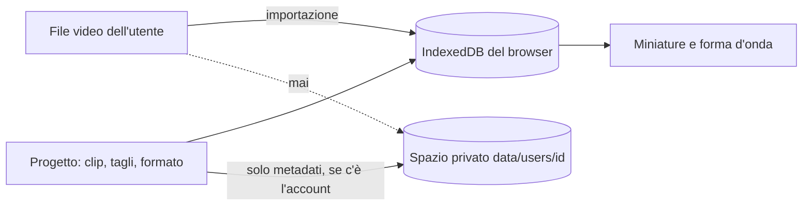
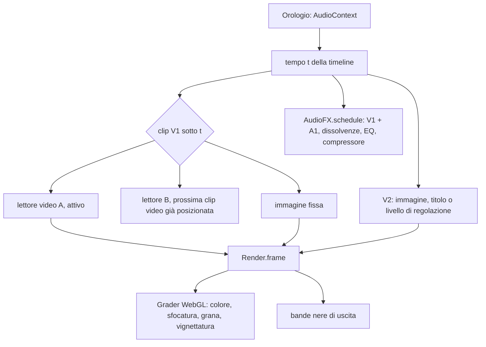
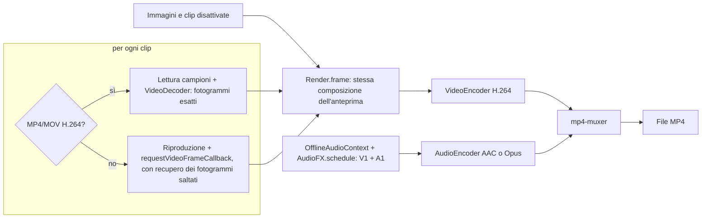

# Architettura

## Scelte principali

| Tema | Scelta | Perché |
|---|---|---|
| Linguaggio | JavaScript moderno senza framework, script classici uniti in un solo file | L'app viene pubblicata come pagina unica e autosufficiente in claude.ai; nessun passaggio di compilazione obbligatorio, sorgenti leggibili da chi studia il progetto |
| Distribuzione | `dist/index.html` con CSS, JavaScript e libreria inclusi | Funziona da claude.ai, da qualsiasi hosting statico e anche con doppio clic |
| Archivio locale | IndexedDB (progetti, file video, miniature, forme d'onda) | Supportato da tutti i browser moderni, regge file di grandi dimensioni |
| Account e sincronizzazione | Capability `db` e `user` del visualizzatore claude.ai, spazio privato `data/users/<id>` | Un vero salvataggio per utente senza un backend da gestire; i video non vengono mai inviati |
| Anteprima | Due elementi `<video>` alternati + audio WebAudio dai buffer decodificati | Cambio clip senza scatti; l'audio dell'anteprima è identico a quello esportato |
| Esportazione | WebCodecs (VideoDecoder, VideoEncoder, AudioEncoder) + mp4-muxer | MP4 H.264 senza server e senza ffmpeg.wasm, che l'ambiente di pubblicazione non permette di caricare |

## Moduli (`src/`)

L'ordine di caricamento è quello in `build.mjs`.

| File | Ruolo |
|---|---|
| `i18n.js` | Testi italiano/inglese, testi legali, funzione `t()` |
| `lib.js` | Utility: creazione sicura del DOM, formati di tempo e peso, icone SVG, preferenze, IndexedDB, salvataggio dei file |
| `engine.js` | **Motore di montaggio puro**, senza interfaccia: V1 con ripple, tracce libere V2/A1 (inserimento senza sovrapposizioni, spostamento, taglio, divisione, slip), gruppi di proprietà (trasformazione, ritaglio, colore, effetti, audio), zoom dinamico, guadagno con dissolvenze, copia/incolla attributi, cronologia, modello e migrazione dei progetti. Coperto dai test unitari |
| `media.js` | Media Pool: video, immagini e audio; verifica del formato, metadati MP4, miniature, decodifica audio, forma d'onda, archiviazione, ricollegamento, pulizia dei file non usati |
| `render.js` | **Composizione condivisa da anteprima ed esportazione**: `Render.frame` (V1 → V2 → livello di regolazione → bande nere), trasformazioni e ritaglio, motore colore/effetti WebGL (`Grader`, con ripiego CPU), titoli; `AudioFX` (dissolvenze, preset EQ e compressore) |
| `player.js` | Anteprima: orologio audio, lettori A/B per i video V1, immagini fisse, velocità, Prima/Dopo, cattura fotogramma |
| `demux.js` | Lettore di contenitori MP4/MOV: indice dei campioni H.264 (stts, ctts, stss, stsc, stsz, stco/co64, edit list) e decodifica esatta con VideoDecoder |
| `export.js` | Preset, scelta dei codec, mix audio con OfflineAudioContext, scrittura MP4; cattura in riproduzione per i formati non MP4; ripiego MediaRecorder |
| `sample.js` | Generazione delle tre clip di esempio (animazioni su canvas + accordi sintetizzati) |
| `store.js` | Elenco, creazione, duplicazione ed eliminazione (in due tempi, annullabile) dei progetti; sincronizzazione con l'account; backup `.json` (`ProjectFile`) e importazione |
| `ui.js` | Componenti: tema, tooltip, messaggi, finestre modali, menu, tutorial, suggerimenti, illustrazioni, scorciatoie |
| `editor.js` | Schermata di montaggio: stato annullabile, Media Pool, anteprima, comandi, tastiera, salvataggio automatico |
| `timeline.js` | Timeline multitraccia (metodi di `Editor`): disegno delle tracce, strumenti Puntatore/Lametta/Slip, aggancio, marker, trascinamenti, menu contestuale |
| `inspector.js` | Inspector (metodi di `Editor`): schede Video, Colore, Effetti, Audio; Incolla attributi; Impostazioni progetto |
| `exportui.js` | Finestra di esportazione (impostazioni, avanzamento, risultato, errore) e procedura "Ritrova i tuoi video" |
| `views.js` | Landing, dashboard, impostazioni, aiuto, pagine legali, 404 |
| `app.js` | Avvio e navigazione (`#home`, `#progetti`, `#editor-<id>`, `#impostazioni`, `#aiuto`, `#privacy`, `#termini`, `#cookie`) |

## Modello dati (schema 2)

```js
Project = {
  id, name, schema: 2, createdAt, updatedAt,
  format: '16:9' | '9:16' | '1:1' | '4:5', fps: 30,
  assets: { [id]: { id, kind: 'video' | 'image' | 'audio', name, size, type, container, duration, width, height, fps, codec, audioCodec, hasAudio, addedAt } },
  tracks: [
    { id: 'v1', kind: 'video',   clips: [Clip] },   // sequenza con ripple: la posizione deriva dall'ordine
    { id: 'v2', kind: 'overlay', clips: [Clip] },   // immagini, titoli, livelli di regolazione: Clip.start
    { id: 'a1', kind: 'audio',   clips: [Clip] },   // musica e voce: Clip.start
  ],
  markers: [{ id, t, color, name }],                // marker della timeline
  settings: { snapping, scaling: 'fit' | 'fill', imageDur, blanking: 'none' | '1.33' | '1.85' | '2.39' },
  thumb   // miniatura per la dashboard, solo locale
}
Clip = {
  id, kind?: 'text' | 'adjust', assetId?, in, out, start?, speed, volume, muted, fit, ox, oy, label?, disabled, markers?: [{ id, at, color, name }],
  tf?:    { zx, zy, link, x, y, rot, flipH, flipV },        // Trasforma
  crop?:  { l, r, t, b },                                   // Ritaglio
  dz?:    { mode: 'off' | 'in' | 'out', amt },              // Zoom dinamico
  comp?:  { opacity, blend: 'normal' | 'screen' | 'multiply' | 'overlay' },
  color?: { lift, gamma, gain, contrast, sat, temp },       // −1..1
  fx?:    { blur, grain, vignette },                        // 0..1
  audio?: { fadeIn, fadeOut, eq: 'neutral' | 'voice' | 'music' | 'lowcut' },
  text?:  { content, size, color, bg, bold, align },
}
```

- I gruppi di proprietà sono facoltativi: `Engine.g(clip, 'tf')` restituisce sempre i valori completi, con i predefiniti per ciò che manca. Così i progetti vecchi restano piccoli e compatibili.
- `Engine.migrate` porta qualsiasi progetto (IndexedDB, cloud, backup `.json`) allo schema corrente: crea le tracce V2 e A1, aggiunge `markers` e le nuove impostazioni, valida i valori e scarta le clip incompatibili con la traccia. Migrare due volte non cambia nulla (verificato dai test).
- La cronologia conserva **istantanee immutabili** di tracce, marker, formato, asset e bande nere: annullare e ripetere è sicuro (300 passi). Gli slider usano `beginLive`/`endLive`: un trascinamento è una sola voce.

## Dove finiscono i dati



Gli archivi in IndexedDB sono quattro: `projects`, `media` (i file originali), `derived` (miniature JPEG, forma d'onda) e le preferenze in localStorage. Quando si elimina un progetto, i file non più usati da nessun altro progetto vengono rimossi.

## Anteprima



Il tempo viene dall'orologio audio. Il lettore attivo viene corretto con piccole variazioni di velocità (moltiplicate per la velocità della clip) se si allontana dal tempo atteso, e con un seek se lo scarto è grande. Al cambio clip i due lettori si scambiano; le immagini non usano lettori. La **qualità anteprima** riduce solo la risoluzione della tela di anteprima: tutte le grandezze del rendering (posizioni, sfocatura, grana) sono relative al fotogramma, quindi il risultato non cambia. **Prima/Dopo** disattiva solo nell'anteprima le correzioni colore.

## Esportazione



- Il fotogramma `k` del file finale appartiene alla clip che contiene l'istante `k/fps`, la stessa regola dell'anteprima, e mostra il fotogramma sorgente con tempo di presentazione ≤ al tempo richiesto. Questo è verificato fotogramma per fotogramma dai test (`docs/TEST.md`).
- Ogni fotogramma d'uscita viene **composto al proprio istante** con `Render.frame`: zoom dinamico, titoli, grana e livelli di regolazione cambiano nel tempo anche quando la sorgente ripete lo stesso fotogramma. La durata del file è quella della traccia più lunga (V1, V2 o A1).
- Il test `e2e6` confronta i fotogrammi del file esportato con quelli dell'anteprima alla stessa risoluzione (PSNR) e verifica le dissolvenze nel mix audio.
- La decodifica diretta tiene conto di B-frame ed edit list, quindi i tempi coincidono con quelli mostrati dal browser e da ffmpeg.
- Il codec H.264 viene scelto tra High, Main e Baseline, con il livello calcolato dalla risoluzione. L'audio è AAC se il browser sa codificarlo, altrimenti Opus.
- Se mancano le WebCodecs, l'esportazione ripiega su MediaRecorder in tempo reale: MP4 se il browser lo supporta, altrimenti WebM.
- Con la scheda nascosta l'esportazione si mette in pausa e riprende al ritorno.

## Account e sincronizzazione

`store.js` chiede al visualizzatore le capability `user` (identità e nome) e `db`. Ogni progetto è un documento `data/users/<id>/proj-<idProgetto>` che contiene i metadati in JSON, senza miniatura. All'apertura i progetti si uniscono: vince la modifica più recente e le eliminazioni lasciano una traccia (`deleted: true`) per non far ricomparire un progetto. Se le capability mancano, ad esempio fuori da claude.ai o senza account, l'app resta in modalità ospite e tutto continua a funzionare in locale.

## Sicurezza

- I testi dell'utente (nomi di file e di progetti) passano sempre da `textContent`; `innerHTML` è usato solo con costanti interne (icone e illustrazioni).
- Nessuna richiesta di rete verso altri siti. Gli unici caricamenti esterni sono i caratteri da Google Fonts.
- I dati letti dal cloud vengono validati e migrati (`Engine.migrate`) prima dell'uso.
