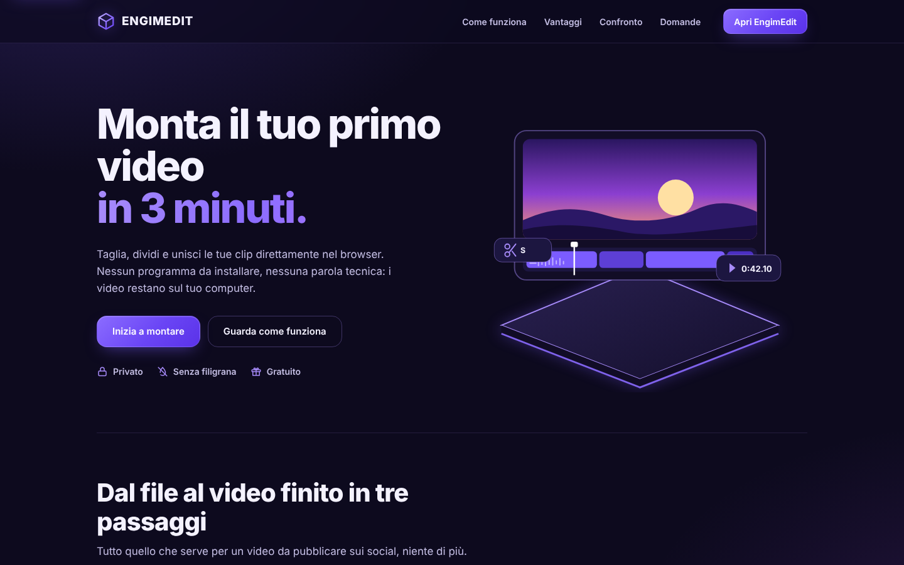
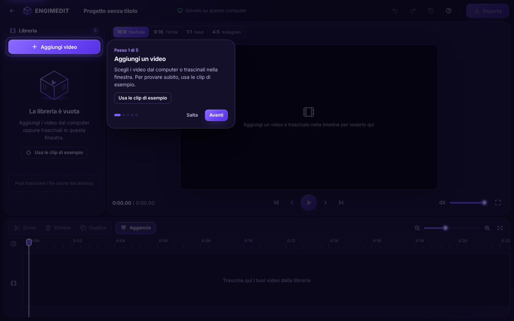
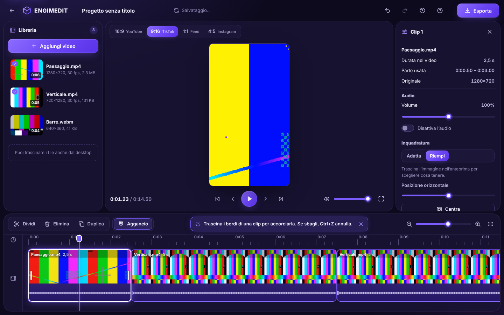
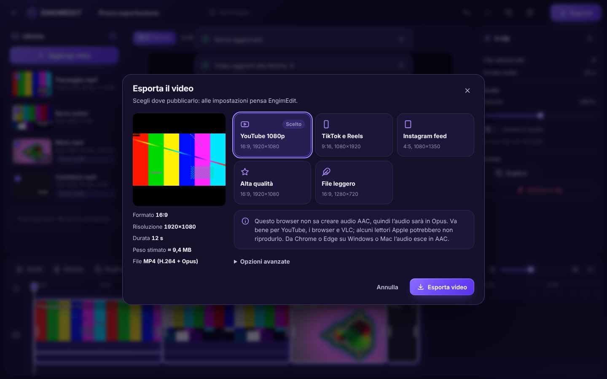
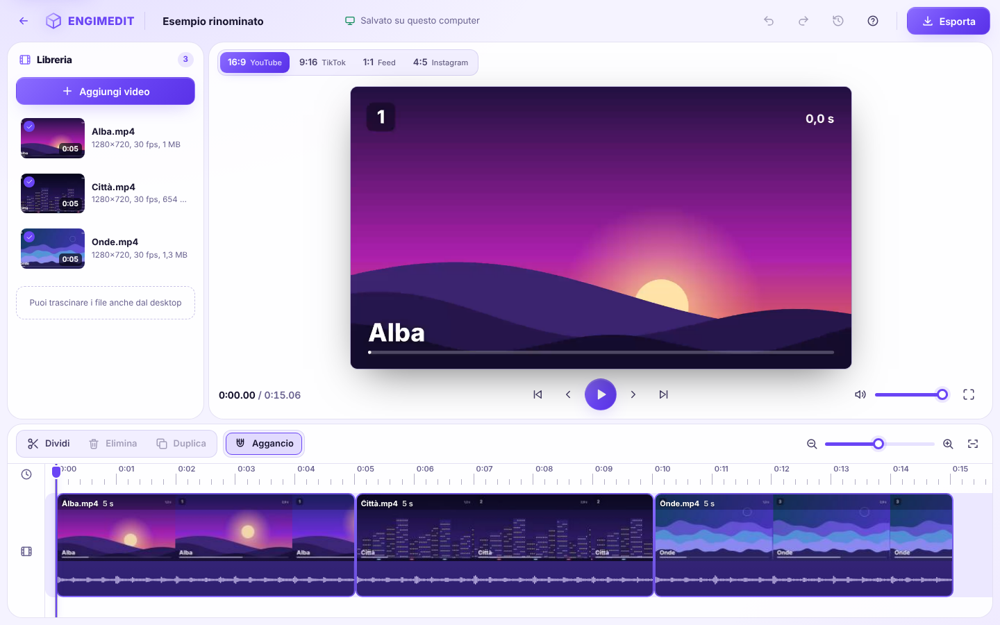
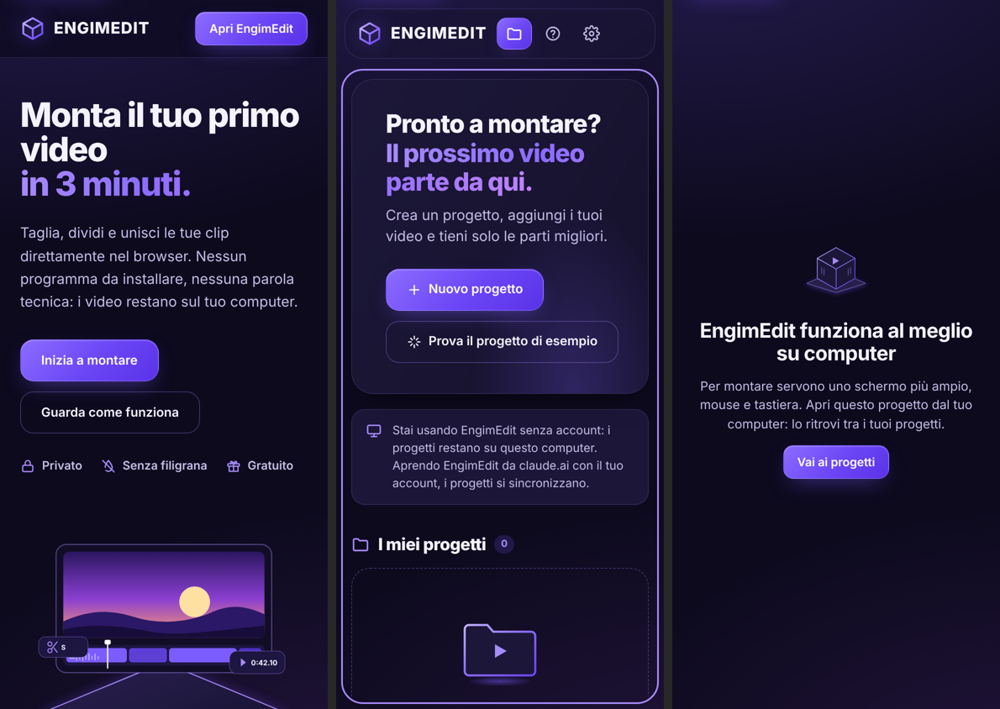

# Design

Lo stile viene dai mockup in `docs/riferimenti/`: sfondo indaco quasi nero, accento viola `#7B5CFF`, logo a cubo isometrico, pannelli "in vetro" con bordi sottili, luci al neon sulle superfici. Tutti i valori sono token CSS in `src/styles.css`. Nessun colore è scritto a mano nei componenti.

## Colori

| Token | Scuro (predefinito) | Chiaro | Uso |
|---|---|---|---|
| `--bg` | `#0d0a1e` | `#f5f3ff` | sfondo della pagina, con due bagliori radiali viola |
| `--surface` / `-2` / `-3` | `#15112b` / `#1c1738` / `#272049` | `#ffffff` / `#f2efff` / `#e7e2ff` | pannelli, campi, elementi sollevati |
| `--text` / `-2` / `-3` | `#f4f2ff` / `#c3bde3` / `#938cb8` | `#17132e` / `#463f66` / `#6a6390` | testo principale, secondario, terziario |
| `--accent` | `#7b5cff` | `#6a45f5` | azione primaria, selezione, cursore |
| `--grad` | `#8b6cff → #6a45f5 → #5a32e8` | uguale | pulsanti primari e voce di menu attiva |
| `--danger` / `--success` / `--warning` | `#ff6b86` / `#45dfa0` / `#ffc266` | `#d6264a` / `#0f8a5a` / `#9a5b00` | stati |

Il tema scuro è il predefinito perché è l'aspetto dei mockup. Da Impostazioni si sceglie Scuro, Chiaro o Sistema, che segue il sistema operativo o il visualizzatore di claude.ai. Uno script nell'intestazione applica il tema prima del primo disegno, per evitare lampi bianchi.

## Tipografia

Il carattere è un'unica famiglia, **Plus Jakarta Sans** (400–800), con ripiego sui caratteri di sistema. La scala va da 12 a 44 px nell'interfaccia; nei titoli della landing arriva fino a 66 px con `clamp()`. I tempi (`0:12.40`) usano cifre tabulari per non "ballare" durante la riproduzione.

## Spaziature, raggi, ombre, movimento

- Spaziature: 4, 8, 12, 16, 24, 32, 48, 72 px.
- Raggi: 6, 9, 12, 16, 22 px, più la forma a pillola.
- Tre livelli d'ombra; nel tema scuro le ombre sono più profonde e i pulsanti primari hanno un bagliore viola.
- Durate: 120, 200 e 320 ms con curva `cubic-bezier(.2,.8,.2,1)`. Con "riduci movimento" attivo nel sistema, le animazioni si annullano.

## Componenti

Il set comprende:
- pulsanti (primario, secondario, contorno, fantasma, pericolo; tre taglie; sola icona);
- campi di testo e menu a tendina;
- selettori segmentati, interruttori, cursori a scorrimento con riempimento;
- finestre modali (`<dialog>` nativo), messaggi temporanei con azione "Annulla", tooltip con scorciatoia;
- menu contestuali navigabili con le frecce;
- barre di avanzamento, scheletri di caricamento, stati vuoti illustrati, avvisi, tutorial a riflettore.

Le illustrazioni sono SVG originali che riprendono il cubo del logo.

## Principi di esperienza

- **Una sola azione primaria per schermata:** *Nuovo progetto* nella dashboard, *Esporta* nell'editor.
- **Niente parole tecniche:** "Dividi", "Taglia", "Adatta / Riempi", "Ritrova i tuoi video".
- **Ogni azione ha una risposta visibile:** messaggio, cambio di stato o anteprima del fotogramma durante il taglio.
- **Ogni errore dice cosa è successo e cosa fare:** ad esempio, per un video HEVC dell'iPhone indica l'impostazione della fotocamera da cambiare.
- **Gli stati vuoti invitano all'azione:** libreria vuota, timeline vuota, nessun progetto.
- **Gli errori non fanno paura:** eliminazioni annullabili, cronologia, conferma solo per le azioni irreversibili.
- **I suggerimenti** compaiono una volta sola, nella barra della timeline, senza coprire i contenuti.

## Accessibilità

- Tutto si usa da tastiera. Nella libreria, Invio aggiunge il video alla timeline. Le clip ricevono il focus e Maiusc+F10 apre il loro menu; i pannelli si ridimensionano con le frecce. Le finestre modali gestiscono il focus e si chiudono con Esc.
- Il focus è sempre visibile, con un anello viola.
- Etichette ARIA su pulsanti a sola icona, clip ("Clip 2 di 5: nome, durata, selezionata"), cursore, cursori a scorrimento e selettori. I messaggi sono annunciati con `aria-live`.
- I contrasti dei testi sono pensati per livello AA in entrambi i temi. Un audit automatico (Lighthouse/axe) non è ancora stato eseguito: vedi `LIMITI-NOTI.md`.

## Responsive

- **Computer:** layout completo a pannelli ridimensionabili.
- **Tablet da 1024 px:** editor utilizzabile, verificato nei test.
- **Telefono:** landing e dashboard si adattano. L'editor mostra il messaggio "EngimEdit funziona al meglio su computer" con un collegamento ai progetti.

## Schermate

| | |
|---|---|
|  |  |
|  |  |
|  |  |
